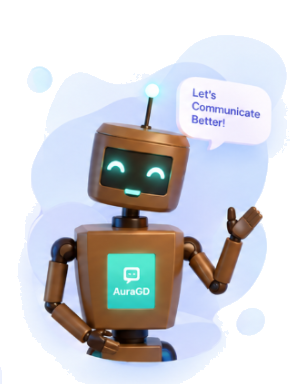
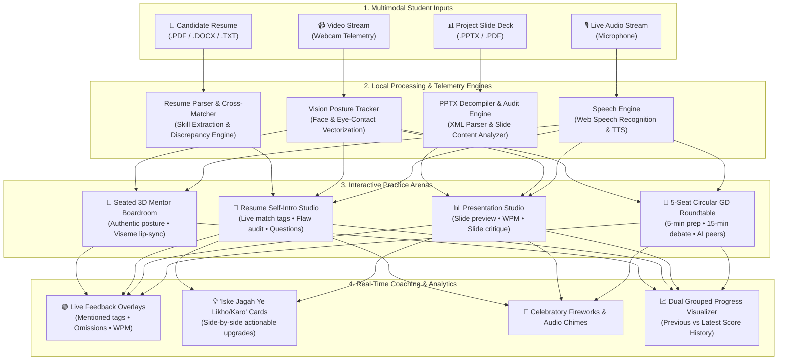

# Baatology 🎙️✨

<div align="center">



# 🗣️ Baatology
### *Speak • Learn • Grow*
**The Next-Generation AI Verbal Mastery & Corporate Readiness Platform**  
*Master 5-Seat Circular Group Discussions, Deliver High-Impact Slide Presentations with AI Slide Audits, and Ace Resume-Aligned Self-Introductions with Zero Anxiety.*

<br/>

[](https://react.dev/)
[](https://vitejs.dev/)
[](https://threejs.org/)
[](https://tailwindcss.com/)
[](https://developer.mozilla.org/en-US/docs/Web/API/Web_Speech_API)
[](#-privacy--client-side-guarantee)
[](LICENSE)

<br/>

[🚀 Live Demo](#-quick-start) • [✨ Why Baatology?](#-why-baatology-the-core-innovation) • [👥 GD Studio](#1--5-seat-circular-group-discussion-gd-studio) • [📊 Presentation Studio](#2--ai-smart-presentation-studio-with-live-slide-audit) • [📄 Resume Self-Intro](#3--resume-powered-self-introduction--interview-studio) • [🛠️ Tech Stack](#%EF%B8%8F-technology-stack)

</div>

---

## 🌟 Overview

**Baatology** is an intelligent, real-time verbal communication and corporate placement readiness platform designed specifically for students, fresh graduates, and professionals. 

Public speaking anxiety, unpracticed group discussions, unstructured project presentations, and weak resume self-introductions account for over **70% of candidate rejections** in top-tier placement rounds. Traditional practice tools fail because they are either passive video recorders or generic chatbots lacking real-time physical, temporal, and topical context.

**Baatology solves this completely** through three immersive, dedicated practice studios paired with a 3D embodied executive mentor:
1. **5-Seat Circular Group Discussion Studio**: Realistic roundtable peer-simulation with dynamic AI student avatars, friend invitations, a 5-minute pre-reading strategy room, and fireworks celebrations.
2. **Project Presentation Studio with AI Slide Audits**: Direct PPT/PPTX and PDF slide submission, live WPM/filler telemetry, slide-specific AI questions, and **"Iske Jagah Ye Karte Toh Zyada Accha Hota"** design & bullet point critiques.
3. **Resume-Linked Self-Introduction & Flaw Detection Studio**: Deep-parses the candidate's resume, live cross-matches spoken words against listed skills/projects with dynamic green tags, asks tailored project follow-ups, and generates side-by-side **"Iske Jagah Ye Likhein"** bullet upgrades to boost ATS strength and eliminate fear.

---

## ✨ Why Baatology? The Core Innovation

| Feature | Conventional Mock Tools | Baatology AI Studio |
|---|---|---|
| **Group Discussions** | Text prompt only or recorded video with delayed reviews. | **Circular 5-Seat Roundtable**: 3 realistic AI peers + 1 candidate + AI moderator, turn-taking, 5-min prep room, 15-min clock, audio repetition drills. |
| **Project Presentations** | Screen recording with no slide context awareness. | **Direct PPTX/PDF Ingestion**: Slide-by-slide preview, live WPM, filler tracking, slide audit engine with concrete improvements, and custom Q&A. |
| **Self-Introduction** | Generic pitch timer with basic filler counters. | **Resume-Aligned Ingestion**: Live speech-to-resume cross-matching (green tags), forgotten highlight reminders, flaw audit & "Iske Jagah Ye Likhein" cards. |
| **Visual Mentorship** | Uncanny 2D video loops or static text bot. | **3D Seated Boardroom Avatar**: Natural human hand posture in lap, authentic skin shading, real-time phonetic viseme lip-sync. |
| **Analytics & History** | Simple average numbers without comparison. | **Dual Grouped Bar Visualizer**: Dark-themed previous vs latest comparison across GD, Presentation & Casual talk with milestone badges. |
| **Data Privacy** | Video/audio streamed to third-party cloud servers. | **100% Client-Side Ingestion**: Speech, camera, and document parsing execute directly in the browser. Zero cloud leaks. |

---

## 🎯 Architecture & Data Flow



---

## 🚀 Interactive Studio Deep Dives

### 1. 👥 5-Seat Circular Group Discussion (GD) Studio
*Simulates the high-pressure environment of campus and corporate placement group discussions with zero fear.*

- **Realistic Circular Roundtable**: Visualized in an authentic 5-chair circle. Contains 3 realistic student avatars (**Rohan**, **Ananya**, **Vikram**), 1 student chair for the candidate, and an automated AI moderator.
- **Add Friends or Intelligent Avatars**: Students can invite their batchmates or toggle avatar participants to practice anytime.
- **5-Minute Topic Prep & Strategy Room**:
  - When a topic is selected (e.g., *"Will AI Replace Software Engineers?"* or *"Electric Vehicles in India"*), Baatology provides essential background context, pros, cons, and key talking points.
  - A 5-minute preparation countdown allows students to structure their arguments before the debate begins.
- **15-Minute Dynamic GD Session**: 
  - Real-time turn-taking and dynamic counter-arguments delivered by AI peers.
  - Active speaker indicators and live air-time tracking.
- **Celebration & Repeat-After-Me Audio Drill**:
  - Automatically triggers congratulatory fireworks confetti upon completing the 15-minute session.
  - Detects spoken grammatical or articulation flaws and prompts the student with a spoken audio drill to repeat the improved corporate phrasing aloud.

---

### 2. 📊 AI Smart Presentation Studio (with Live Slide Audit)
*Eliminates the fear of project and capstone defense by pairing slide rendering with live presentation telemetry.*

- **Direct PPT / PPTX & PDF Submission**:
  - Drag and drop your project presentation file directly into the browser.
  - Automatically extracts and renders clean, high-resolution slide previews without needing mobile conversions or third-party cloud converters.
- **Live Slide-by-Slide Telemetry Dashboard**:
  - **Pacing**: Live Words-Per-Minute (WPM) tracking with target green zones (120–150 WPM).
  - **Hesitation Counter**: Real-time detection of fillers (*"umm"*, *"like"*, *"basically"*, *"you know"*).
  - **Eye Contact & Confidence Index**: Camera-assisted gaze estimation to reward direct audience engagement.
  - **Duration Stopwatch**: Live timer to ensure the presentation stays within corporate time limits.
- **AI Slide Flaw Audit ("Iske Jagah Ye Karte Toh Zyada Accha Hota")**:
  - Analyzes slide text density, bullet conciseness, and structural clarity.
  - Provides side-by-side improvement cards: e.g., *"Slide 3 is text-heavy. Instead of 6 long sentences, convert to 3 bullet points with quantifiable metrics (+40% speedup)."*
- **Dynamic Slide-Contextual Follow-Up Q&A**:
  - Formulates relevant technical questions directly from the student's slide content to test depth of knowledge.
- **Post-Presentation Applause**: Audio clapping, victory chime, and structured rubric breakdown.

---

### 3. 📄 Resume-Powered Self-Introduction & Interview Studio
*Transforms nervous elevator pitches into polished, confident corporate introductions.*

- **Resume Ingestion & Parsing**:
  - Upload resumes in `.pdf`, `.docx`, or `.txt` format.
  - Includes **1-Click Curated Engineering Profiles** (SDE / Full-Stack & AI / Data Science) for rapid instant testing.
- **AI Resume Health Audit & ATS Flaw Detector**:
  - Audits the resume for passive verbs, missing metrics, and weak action phrasing.
  - **"Iske Jagah Ye Likhein" (Better Alternative) Cards**: Shows exactly how to rewrite weak points (e.g., replacing *"Worked on backend"* with *"Architected high-throughput REST APIs reducing query latency by 35%"*).
- **Live Speech vs. Resume Cross-Matcher**:
  - 🟢 **Mentioned Resume Items**: Real-time green tags illuminate as the candidate articulates their college, degree, core skills, and flagship projects.
  - 🟡 **Omitted Highlights**: Smart reminders flag high-impact projects or achievements listed on the resume that the student forgot to highlight.
  - 🔴 **Inconsistency Detector**: Instantly alerts the candidate if their spoken introduction contradicts listed graduation dates or roles.
- **Contextual Dynamic Interview Questions**:
  - AI dynamically derives specific interview questions from the candidate's actual projects (e.g., *"You mentioned using Redis in your E-commerce project—how did you manage cache invalidation?"*).
- **Speech Flaw Correction & Executive Rewrites**:
  - Identifies informal campus phrasing (e.g., *"Myself Pragya..."* ➔ *"I am Pragya..."*, *"Passed out from..."* ➔ *"Graduated from..."*).

---

### 4. 📈 Interactive Progress Analytics & Historical Consistency
*Visualizes concrete day-by-day improvement to build unshakeable speaking confidence.*

- **Dual Grouped Bar Visualizer**:
  - Sleek, dark-themed grouped bar chart comparing **Previous Score (Indigo)** vs. **Latest Score (Emerald)** across Group Discussion, Presentation, and Casual Speaking.
- **Date-Wise Consistency Table**:
  - Tracks historical practice sessions with exact timestamps, domain categories, overall score out of 100, measured eye-contact percentage, filler counts, and milestone achievement badges.
  - Features an active `+31% Growth 🔥` indicator to keep students motivated.

---

### 5. 🤖 3D Embodied AI Executive Mentor
*A comfortable, photorealistic environment that replaces intimidating interview panels with a supportive AI mentor.*

- **Modern Glass Boardroom Environment**: High-tech corporate executive office featuring ambient floor-to-ceiling glass architecture and soft daylight reflections.
- **Natural Seated Posture**: Designed with natural human seated ergonomics—arms resting gently along the torso, relaxed hands placed comfortably in the lap, free of robotic or awkward poses.
- **High-Fidelity Skin & Shader Rendering**: Authentic skin tones, soft depth of field, and natural neck/head geometry.
- **Live Phonetic Viseme Lip-Sync**: Realistic lip and mouth movements synchronized with AI voice synthesis.
- **Vision-Based Posture & Eye-Contact Alerts**: Real-time polite notifications when slouching or losing eye contact.

---

## 🛠️ Technology Stack

| Layer | Technologies | Purpose |
|---|---|---|
| **Frontend Framework** | `React 18`, `Vite 5.4` | High-performance SPA with instant HMR and lightweight bundle size. |
| **Styling & Icons** | `Tailwind CSS 3.4`, `Lucide React` | Responsive, modern executive UI with sleek cards, badges, and animations. |
| **3D Rendering & Avatars** | `Three.js`, `@react-three/fiber`, `@react-three/drei` | 3D boardroom scene, humanoid mesh rendering, lighting, and camera management. |
| **Document Processing** | `pdfjs-dist`, `jszip` (PPTX XML parser) | 100% in-browser extraction of resume text and presentation slide content. |
| **Speech Recognition & TTS**| Native `Web Speech API` (`SpeechRecognition`, `SpeechSynthesis`) | Zero-latency, client-side speech-to-text and female executive voice delivery. |
| **Audio Telemetry** | `Web Audio API` (`AudioContext`, `AnalyserNode`) | Real-time audio frequency detection, voice activity detection, and mic volume. |
| **Celebrations** | `canvas-confetti`, custom synthesized Web Audio chimes | Visual fireworks and celebratory audio cues upon session completion. |
| **Backend API** | `Node.js`, `Express` (Port 3001) | Lightweight local companion server for auxiliary services and file management. |

---

## 💻 Getting Started

### Prerequisites
- **Node.js**: v18.0.0 or higher ([Download Node.js](https://nodejs.org/))
- **npm** (bundled with Node.js) or **yarn**
- **Recommended Browsers**: Google Chrome, Microsoft Edge, or Brave (for full Web Speech API and WebGL support)

### Installation & Launch

1. **Clone the Repository**:
   ```bash
   git clone https://github.com/pragyakatiyar73-cyber/Baatology.git
   cd Baatology
   ```

2. **Install Dependencies**:
   ```bash
   npm install
   ```

3. **Launch the Backend API Server**:
   ```bash
   node server.js
   ```
   *The backend starts on `http://localhost:3001`.*

4. **Launch the Frontend Development Server** (in a separate terminal):
   ```bash
   npm run dev
   ```
   *The Vite development server will open on `http://localhost:3000`.*

5. **Build for Production**:
   ```bash
   npm run build
   ```
   *Generates an optimized, minified production build in the `dist/` directory.*

---

## 📂 Project Structure

```text
Baatology/
├── public/
│   ├── backgrounds/                # Photorealistic 3D boardroom & office environments
│   ├── models/                     # 3D GLB humanoid meshes & custom textures
│   ├── slides/                     # Presentation temporary cache
│   ├── uploads/                    # Uploaded resume documents
│   ├── robot_mascot_transparent.png # Baatology transparent brand mascot
│   └── favicon.ico
├── src/
│   ├── components/
│   │   ├── Dashboard/              # Executive dashboard, sidebar & progress visualizer
│   │   │   ├── Dashboard.jsx
│   │   │   ├── Sidebar.jsx
│   │   │   ├── CommunicationProgressBarChart.jsx
│   │   │   ├── HistoryView.jsx
│   │   │   └── LoginModal.jsx
│   │   ├── GDStudio/               # Circular 5-seat Group Discussion arena
│   │   │   ├── GroupDiscussionStudio.jsx
│   │   │   ├── GDTopicModal.jsx
│   │   │   ├── GDTopicPrepModal.jsx
│   │   │   └── GDReviewAndPracticeModal.jsx
│   │   ├── Presentation/           # PPT slide presenter & live telemetry
│   │   │   └── PresentationStudio.jsx
│   │   ├── SelfIntro/              # Resume-linked self-introduction & interview studio
│   │   │   └── ResumeSelfIntroStudio.jsx
│   │   ├── Mentorship/             # 3D seated mentor avatar & dual-video room
│   │   │   └── DualVideoMentorshipRoom.jsx
│   │   └── AuraGD/                 # 3D Avatar canvas, webcam PIP & dock controls
│   ├── hooks/
│   │   ├── useSpeechRecognition.js # Speech-to-text with auto-restart & silence detection
│   │   ├── useSpeechSynthesis.js   # Text-to-speech with pitch & rate tuning
│   │   ├── useWebcam.js            # Video stream & camera state management
│   │   ├── useVisionPostureTracker.js # Gaze and posture estimation
│   │   └── useGroupDiscussionSession.js # GD state machine, turns & avatars
│   ├── utils/
│   │   ├── resumeParser.js         # PDF extraction, ATS audit & speech cross-matching
│   │   ├── pptxParser.js           # PPTX decompiler & slide improvement engine
│   │   ├── gdFeedbackEngine.js     # Avatar personalities, debate logic & scoring
│   │   ├── progressHistory.js      # Date-wise consistency history engine
│   │   ├── femaleVoiceManager.js   # Optimal browser female voice selection
│   │   ├── celebration.js          # Fireworks confetti & congratulations triggers
│   │   └── chime.js                # Web Audio API celebratory sound synthesizer
│   ├── App.jsx                     # Top-level view router & state orchestrator
│   ├── index.css                   # Tailwind directives & custom CSS animations
│   └── main.jsx                    # React application entry point
├── server.js                       # Express companion server
├── vite.config.js                  # Vite configuration
├── package.json                    # Project metadata & dependencies
└── README.md                       # Comprehensive documentation
```

---

## 🔒 Privacy & Client-Side Guarantee

Baatology was built with a fundamental commitment to candidate privacy:
- **No Cloud Video or Audio Streaming**: All speech-to-text recognition, gaze tracking, posture estimation, and voice synthesis execute **100% locally** on the user's browser via native Web APIs.
- **In-Memory Document Parsing**: Resumes and presentation decks uploaded by candidates are parsed directly in browser memory using JavaScript libraries (`pdfjs-dist` and `jszip`). Documents are never uploaded or indexed by third-party training pipelines.
- **Local Progress Persistence**: Practice session histories, scores, and analytics are stored directly in the candidate's browser `localStorage`, remaining completely under user control.

---

## 🗺️ Roadmap & Upcoming Milestones

- [x] **Circular 5-Seat GD Studio**: With 5-min strategy room, AI avatars & fireworks celebration.
- [x] **Project Presentation Studio**: PPTX/PDF rendering, live WPM/filler telemetry, and slide audits.
- [x] **Resume-Linked Self-Introduction**: Speech-to-resume cross-matching, flaw detection & "Iske Jagah Ye Likhein" cards.
- [x] **3D Seated Executive Avatar**: Natural human posture, authentic skin shading, and viseme lip-sync.
- [ ] **Multiplayer WebRTC Rooms**: Invite real classmates into the 5-seat GD roundtable via peer-to-peer WebRTC connections.
- [ ] **Multilingual Support**: Real-time translation and practice support in Hindi, Hinglish, and regional Indian languages.
- [ ] **Automated Mock Placement Drive**: End-to-end full placement simulation (Aptitude test ➔ GD Round ➔ Tech PPT Round ➔ HR Interview).

---

## 🤝 Contributing

Contributions make the open-source community an amazing place to learn, inspire, and create. Any contributions to **Baatology** are **greatly appreciated**!

1. Fork the Project
2. Create your Feature Branch (`git checkout -b feature/AmazingFeature`)
3. Commit your Changes (`git commit -m 'Add some AmazingFeature'`)
4. Push to the Branch (`git push origin feature/AmazingFeature`)
5. Open a Pull Request

---

## 📄 License

Distributed under the **MIT License**. See `LICENSE` for more information.

---

<div align="center">

**Made with ❤️ for students, dreamers, and future leaders by [Pragya Katiyar](https://github.com/pragyakatiyar73-cyber)**  
*Empowering every candidate to speak with clarity, confidence, and conviction.*

<br/>

[](https://github.com/pragyakatiyar73-cyber/Baatology)
[](https://github.com/pragyakatiyar73-cyber/Baatology)

</div>